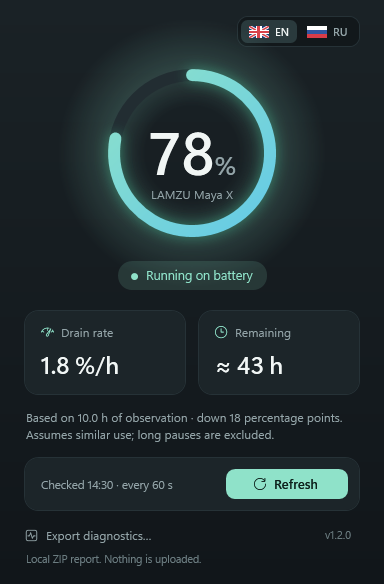
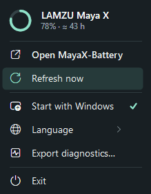
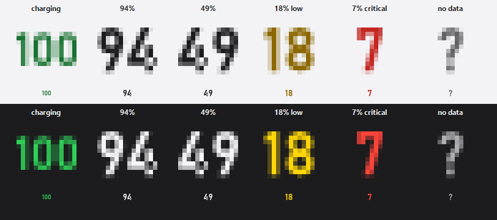

# 🖱️ MayaX-Battery

A small Windows tray app that shows the battery level of the [LAMZU Maya X](https://lamzu.com/products/lamzu-maya-x) and estimates how long the charge will last.

[](https://github.com/0xLaileb/Lamzu.MayaX-Battery/releases/latest)
[](https://github.com/0xLaileb/Lamzu.MayaX-Battery/actions/workflows/ci.yml)
[](#requirements)
[](global.json)
[](LICENSE)

| Details window | Tray menu |
| :---: | :---: |
|  |  |



> [!NOTE]
> The screenshots use demonstration data. They do not show live readings from a connected mouse.

## Quick start

1. Download the latest ZIP from [GitHub Releases](https://github.com/0xLaileb/Lamzu.MayaX-Battery/releases/latest) and extract it to a permanent folder, such as `C:\Apps\MayaX-Battery`.
2. Run `MayaX-Battery.exe`. The details window opens and the battery percentage appears in the notification area.
3. Right-click the tray icon and turn on **Start with Windows** if you want the indicator after every sign-in.

No installer and no separate .NET runtime are needed. To remove the app, turn off **Start with Windows**, choose **Exit**, and delete the folder.

> [!TIP]
> Windows decides which tray icons stay visible. Open the hidden icons menu (`^`) and drag the battery number onto the taskbar to keep it in view. See [Microsoft's taskbar guide](https://support.microsoft.com/en-us/windows/experience/personalization/customize-the-taskbar-in-windows).

## Contents

- [What it does](#what-it-does)
- [Using the app](#using-the-app)
- [Start with Windows](#start-with-windows)
- [Troubleshooting](#troubleshooting)
- [Command-line options](#command-line-options)
- [Diagnostics](#diagnostics)
- [Adapt another mouse with an AI agent](#adapt-another-mouse-with-an-ai-agent)
- [Build from source](#build-from-source)
- [Project structure](#project-structure)
- [Contributing](#contributing)
- [License](#license)

## What it does

| Feature | Details |
| --- | --- |
| Tray battery indicator | Shows the percentage as a number, with separate colors for charging, low, critical and unavailable readings. The numerals adapt to light and dark taskbars. |
| Runtime estimate | Uses readings taken while discharging. An estimate appears after at least 30 minutes of observation and a drop of at least 2 percentage points. Charging periods and long gaps are excluded. |
| Low battery notification | Shows one Windows notification when the charge falls to 20% or less and another at 10% or less. It is re-armed once the charge is back above 22%. |
| Polling and recovery | Checks about once per minute. After a failed read it retries after 15 seconds up to four times, then returns to the 60-second interval. |
| Start with Windows | One menu item adds or removes a per-user startup entry that keeps the app in the tray. |
| English and Russian | Switch with the flag buttons in the window or from the tray menu. The choice applies immediately and is saved. The first launch follows the Windows display language when it is Russian; otherwise it uses English. |
| Local data only | History and the language preference stay under `%LOCALAPPDATA%\MayaX-Battery`. Nothing is uploaded. Data from the older `%LOCALAPPDATA%\MouseBattery` folder is copied when needed; the originals are preserved. |
| Diagnostics | Saves a local ZIP with relevant HID metadata, candidate selection reasons and recent polling events. Collection sends no vendor commands. |
| Standalone app | A self-contained, single-file Windows x64 executable. |

The project targets the LAMZU Maya X. A battery reading was checked on this model on September 3, 2026. Compatibility with other devices has not been established.

## Using the app

### Tray icon

| Icon | Meaning |
| --- | --- |
| White or dark number | Battery percentage while running on battery. |
| Yellow number | Low battery, 20% or less. |
| Red number | Critical battery, 10% or less. |
| Green number | The mouse is charging. |
| Grey `?` | No reading yet, or the mouse did not answer. This is not treated as an empty battery. |

Hover over the icon to see the device name, the percentage and the remaining time when an estimate is available.

| Action | Result |
| --- | --- |
| Click the icon | Opens the details window, or brings it forward. |
| Right-click the icon | Opens the menu described below. |
| Run `MayaX-Battery.exe` again | Brings the existing window forward. Only one copy runs. |

### Tray menu

| Item | What it does |
| --- | --- |
| Status header | Shows the device name, the percentage and the remaining time, with a small ring gauge in the same colors as the window. |
| **Open MayaX-Battery** | Opens the details window. |
| **Refresh now** | Reads the battery immediately instead of waiting for the next check. |
| **Start with Windows** | Adds or removes the startup entry. A check mark means it is on for this copy of the app. |
| **Language** | Switches between English and Russian. |
| **Export diagnostics...** | Saves a local ZIP report. See [Diagnostics](#diagnostics). |
| **Exit** | Closes the window and removes the tray icon. |

### Details window

The window shows the percentage on a ring gauge that changes color with the charge state, the drain rate in percent per hour, the remaining time, and when the battery was last checked. The version in the bottom corner opens the releases page. Closing the window keeps the app running in the tray.

| Key | Action |
| --- | --- |
| <kbd>F5</kbd> | Refresh the reading. |
| <kbd>Esc</kbd> | Close the window. The tray icon stays. |
| <kbd>Tab</kbd>, <kbd>Enter</kbd> | Move between buttons and activate them. |

<details>
<summary>How the remaining time is estimated</summary>

The app records how fast the percentage falls while the mouse runs on battery, then divides the current percentage by that rate. It needs at least 30 minutes of observation and a 2-point drop before it shows a number. Charging, failed reads and gaps longer than 12 minutes are left out, and history older than 14 days is dropped. The result is an approximation that assumes similar use, not a guarantee. [How it works](docs/how-it-works.md) has the full description with diagrams.

</details>

## Start with Windows

Right-click the tray icon and choose **Start with Windows**. The app adds an entry for your Windows account that starts this executable with `--tray`, so it appears in the notification area without opening a window. Choose the item again to remove the entry.

- Extract the app to a permanent folder first. The item refuses to register a copy running from the temporary folder, for example one started from inside the ZIP.
- The entry points to the executable's current location. If you move the folder, the check mark disappears; turn the item on again from the new location.
- Windows can disable startup apps separately. If the app does not start after sign-in, open **Settings > Apps > Startup** and enable **MayaX-Battery**.
- Desktop shortcuts should stay without `--tray` so they open the window.

<details>
<summary>Manual alternative: a shortcut in the Startup folder</summary>

1. Press <kbd>Win</kbd> + <kbd>R</kbd>, enter `shell:startup`, and press <kbd>Enter</kbd>.
2. Right-click an empty area in that folder and choose **New > Shortcut**.
3. Enter the executable path followed by `--tray`, for example `"C:\Apps\MayaX-Battery\MayaX-Battery.exe" --tray`.
4. Name the shortcut **MayaX-Battery** and click **Finish**.

Use either the menu item or a shortcut, not both. A repeated `--tray` launch leaves the running app and its window unchanged. To stop automatic startup, delete the shortcut from `shell:startup`.

</details>

## Troubleshooting

<details>
<summary>The icon shows <code>?</code> or the window says the mouse is not responding</summary>

- Move the mouse to wake it, then choose **Refresh now**.
- Check that the receiver or cable is connected. Try another USB port.
- Close other tools that talk to the mouse, such as the vendor configuration software, and refresh again.
- If the problem stays, choose **Export diagnostics...** and review the report. See [collecting a compatibility report](docs/diagnostics.md).

A failed read never becomes a 0% reading and does not erase the saved history.

</details>

<details>
<summary>The window says "Device not found"</summary>

The app looks for a LAMZU vendor interface with vendor ID `373E`. Other mice, including other LAMZU models, may expose a different interface. Their support is unverified. The diagnostic report lists what Windows exposes for your device.

</details>

<details>
<summary>The remaining time shows dots</summary>

The estimate needs 30 minutes of discharge readings and a drop of 2 percentage points. It is also hidden while the mouse charges. The note under the two tiles says what is still missing.

</details>

<details>
<summary>The tray icon is missing</summary>

Windows may have moved it into the hidden icons menu (`^`). Drag it onto the taskbar. If the app is not running, start `MayaX-Battery.exe` again.

</details>

<details>
<summary>No low battery notification appears</summary>

Each level notifies once, until the mouse has been charged above 22%. Windows also hides notifications while Do not disturb is on, and when notifications are turned off under **Settings > System > Notifications**.

</details>

## Command-line options

| Option | Purpose |
| --- | --- |
| *(none)* | Open the details window and start the tray icon. A second launch brings the existing window forward. |
| `--tray` | Start with only the tray icon. Used by the startup entry. Repeating it does not open a window. |
| `--diagnostics` | Save a diagnostic ZIP beside the executable without opening any UI. Must be the only argument. Exit code `0`: saved, `1`: export failed, `2`: invalid arguments. |
| `--diagnostics-only [--language en\|ru]` | Open a separate passive instance that never polls the battery and saves no history or preferences. Use it to export a report when normal polling is stuck. |

The executable also has `--preview`, `--ui-preview` and `--menu-preview` modes that render the screenshots in this README from demonstration data. They are development aids and do not access the mouse.

## Diagnostics

**Export diagnostics...** in the window or tray menu saves a ZIP to a location you choose. `MayaX-Battery.exe --diagnostics` does the same without UI and writes a uniquely named ZIP beside the executable. A saved report may still describe an incomplete device scan; read `summary.txt` inside it.

The report is a scoped, passive snapshot. It excludes device paths, serial numbers and full HID frames. Firmware versions stay unknown and HID report IDs are not collected. See [collecting a compatibility report](docs/diagnostics.md) for wired and wireless collection steps and for what the files contain.

## Adapt another mouse with an AI agent

If you use an AI coding agent, [agent-adaptation-prompt.md](docs/agent-adaptation-prompt.md) provides a reusable workflow for investigating and adapting this app to your mouse in your own fork. The file contains only instructions for the agent, so you can point the agent directly to it.

1. Fork this repository from `main` and open a local checkout of your fork in your agent.
2. Tell the agent: "Follow `docs/agent-adaptation-prompt.md` to investigate and adapt this fork to my mouse."
3. Provide your exact mouse model and diagnostic ZIP files when available. The agent will ask for missing details and can help collect reports or build the diagnostic executable.

The workflow covers source review, official protocol research, a compatibility plan, implementation in the fork, tests and a local build. A diagnostic report alone may not establish a safe battery protocol. Support for another model remains unverified until tested on that exact mouse and receiver; this upstream project still targets Maya X.

## Build from source

### Requirements

- Windows 10, version 22H2, or Windows 11, x64.
- .NET SDK 10.0.401, pinned in `global.json`, with C# 14.
- A LAMZU Maya X mouse or receiver for live readings. The automated checks do not need a connected device.

### Build and check

From PowerShell at the repository root:

```powershell
dotnet build src/MayaX-Battery.csproj -c Release
dotnet run --project tests/Checks.csproj -c Release
```

The checks run as a console program, not through `dotnet test`. They cover response parsing, the runtime estimate, storage and migration, localization, the low battery alert and icon rendering without touching HID hardware or your saved data.

### Package

```powershell
.\tools\Build-Release.ps1 -Version 0.0.0-dev
```

The package and its SHA-256 checksum are written to `artifacts/release/`. The script also smoke-checks the published executable through its preview modes. GitHub Actions runs the same build, checks and packaging on every push to `main` and on pull requests.

## Project structure

| Path | Purpose |
| --- | --- |
| `src/` | Tray app, details window, HID access, battery polling, runtime history, diagnostics. |
| `tests/` | Hardware-independent console checks. |
| `tools/` | Release packaging, screenshot refresh and app icon build. |
| `docs/` | Screenshots, [how it works](docs/how-it-works.md), the [HID protocol note](docs/protocol.md), [diagnostics](docs/diagnostics.md) and the [agent prompt](docs/agent-adaptation-prompt.md). |
| `.github/workflows/` | Continuous integration and the tag-triggered draft release. |
| `AGENTS.md`, `CLAUDE.md`, `.codex/`, `.claude/` | Project guidance and focused procedures for coding assistants. |

## Contributing

Bug reports and change proposals are welcome through GitHub Issues and Pull Requests. See [CONTRIBUTING.md](CONTRIBUTING.md) for local checks and device compatibility notes.

## License

This project is available under the [MIT License](LICENSE). You may use, modify, distribute and sell the software, provided that the copyright and license notices are retained.