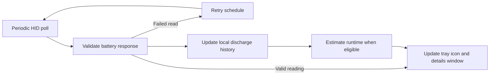
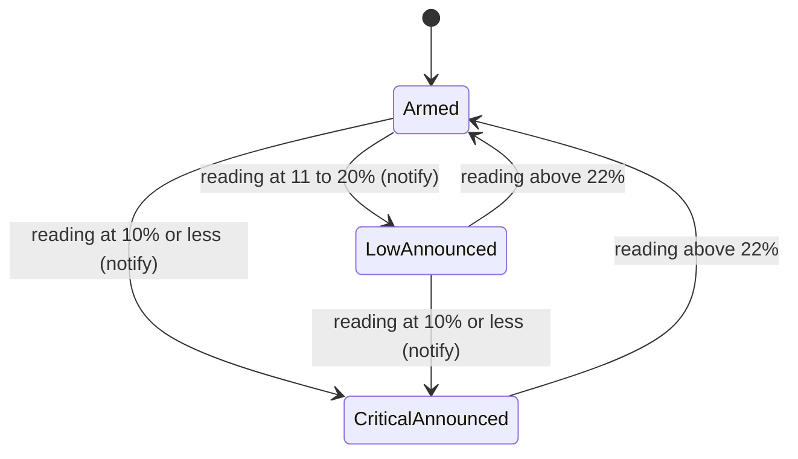
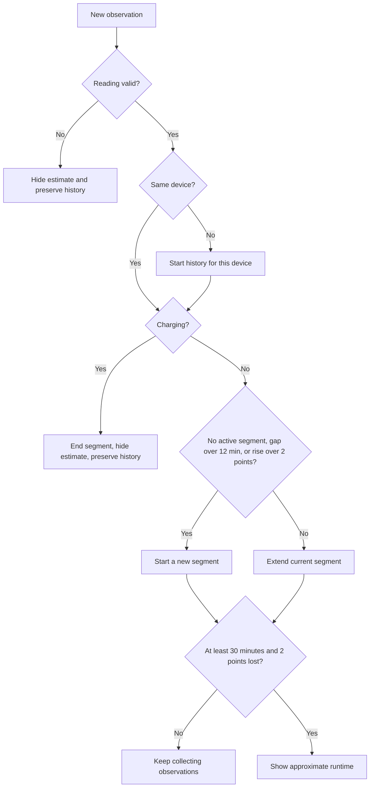

# How it works

MayaX-Battery enumerates present HID interfaces and selects a LAMZU vendor collection with the expected feature report size. It sends a battery-level request, validates the response and retries invalid or empty replies up to four times. A zero percent response is invalid because this protocol uses zero as a no-answer sentinel. The HID report fields and response checks are documented in [the HID protocol note](protocol.md).

Successful readings update the tray icon, the tray menu status line and the details window, and are recorded locally. The app normally checks about once per minute. After a failed read, it retries after 15 seconds up to four times, then returns to its regular interval.

## Charge states

The icon, the menu status dot and the window share one set of thresholds, so they always agree.

| State | Condition | Color |
| --- | --- | --- |
| Charging | The mouse reports the charging flag | Green icon, mint in the window |
| Normal | More than 20% | White or dark icon, mint in the window |
| Low | 11% to 20% | Yellow |
| Critical | 10% or less | Red |
| Unknown | No valid reading | Grey `?` |

An unknown state is never treated as an empty battery. A failed read keeps the saved history and does not trigger a notification.

## Low battery notification

The app shows one Windows notification when a reading enters the low state and one more when it enters the critical state. Later readings in the same state stay silent, and a charging mouse is not announced. A reading above 22% re-arms the notification; the two-point margin keeps sensor jitter around 20%, or a short top-up, from repeating it.

## Runtime estimate

The runtime estimate uses successful readings for the same device while it is discharging. Charging or an invalid read hides the estimate while preserving saved history. A gap longer than 12 minutes starts a new segment so time while the device is unavailable or the app is asleep is not counted. The app retains up to 14 days of history. An estimate appears after at least 30 minutes of observations and a drop of at least 2 percentage points. It is an approximation based on prior readings, not a battery-life guarantee.

## Start with Windows

The **Start with Windows** menu item writes a `MayaX-Battery` value under `HKEY_CURRENT_USER\Software\Microsoft\Windows\CurrentVersion\Run`. The command is the executable's full path followed by `--tray`, so sign-in starts the app in the notification area without opening the window. The menu shows a check mark only when the stored command matches the running executable. A copy running from the temporary folder is not registered, because that path would not survive a restart. Turning the item off deletes the value. The passive `--diagnostics-only` instance does not offer this item.

## Local files

| File | Content |
| --- | --- |
| `%LOCALAPPDATA%\MayaX-Battery\settings.json` | Selected language. |
| `%LOCALAPPDATA%\MayaX-Battery\history.json` | Discharge segments for the runtime estimate, up to 14 days. |

Both files are written through a temporary file and replaced in one step. A missing, oversized or malformed file falls back to defaults without stopping the app. An unreadable `history.json` is first copied to `history.json.bad`, because the next save starts a new history.